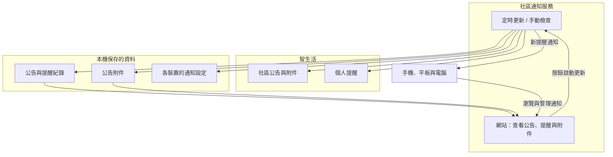

# smartdaily-web

[](https://github.com/shuangrain/smartdaily-web/actions/workflows/ci.yml)
[](https://github.com/shuangrain/smartdaily-web/releases)
[](https://github.com/shuangrain/smartdaily-web/pkgs/container/smartdaily-web)

提供手機、平板與電腦使用的社區公告與提醒服務，也支援 iPhone 和 iPad 加入主畫面後接收通知。

公告與提醒會定時更新，網頁顯示已保存的內容。按「⚡ 立即更新」會檢查新訊息，完成後重新載入目前頁面。

若已有舊版公告、提醒或裝置設定，首次啟動時會自動沿用，原有資料檔也會保留。

1. **📢 社區公告**：公告內文與 PDF、圖片附件會保存下來。即使公告之後被社區撤下，已保存的內容仍可查看。
2. **📬 我的提醒**：查看包裹、寄放物、社區公告、個人通知與其他提醒，也可以按類型篩選。
3. **📲 新訊息通知**：有新提醒時會通知已訂閱的裝置；各裝置分別保存自己的通知設定與接收紀錄。

> [!WARNING]
> **⚠️ 免責聲明 (Disclaimer)**  
> 本工具僅供個人技術測試、研究與教學交流使用，與「今網智生活（智生活科技股份有限公司）」無任何官方合作或關聯。  
> 使用本工具進行任何 API 呼叫、自動化作業所衍生之任何帳號異常、資料外洩或法律責任，開發者與貢獻者概不負任何形式之責任。請使用者確保在獲得適當授權之環境下使用，並妥善保管您的 `DEVICE_ID`（等同於長期登入憑證）。

---

## 🏗️ 資料如何更新與顯示



---

## 🐳 使用 Docker 快速部署

CI 已自動建置並推送映像檔至 GitHub Container Registry (`ghcr.io/shuangrain/smartdaily-web:latest`)：

### 1. 直接使用 GHCR 映像檔啟動

```bash
docker run -d \
  --name smartdaily-web \
  --restart unless-stopped \
  -p 8000:8000 \
  -e DEVICE_ID="您的DeviceID" \
  -v $(pwd)/data:/app/data \
  ghcr.io/shuangrain/smartdaily-web:latest
```

### 2. 使用 `docker-compose.yml`

建立 `docker-compose.yml` 並直接拉取 GitHub Container Registry 映像檔啟動：

```yaml
services:
  smartdaily-web:
    image: ghcr.io/shuangrain/smartdaily-web:latest
    container_name: smartdaily-web
    restart: unless-stopped
    ports:
      - "8000:8000"
    environment:
      - DEVICE_ID=您的DeviceID
      - POLL_INTERVAL_SECONDS=180
      - FULL_SYNC_INTERVAL_SECONDS=86400
      - LOG_LEVEL=INFO
    volumes:
      - ./data:/app/data
```

啟動服務：

```bash
docker compose up -d
```

系統預設每 3 分鐘查看最新訊息，並每 24 小時重新檢查所有公告與提醒。若要調整完整檢查的間隔，可設定 `FULL_SYNC_INTERVAL_SECONDS`，單位為秒（例如 `43200` 代表 12 小時）。

---

## 🚀 本機開發與啟動（使用 `uv`）

```bash
# 安裝相依套件
uv sync

# 設定環境變數並啟動服務
DEVICE_ID="您的DeviceID" uv run smartdaily-web
```

預設監聽 `http://0.0.0.0:8000`。

---

## 📱 iOS (iPhone / iPad) 開啟 PWA 推播步驟

1. 將本服務透過 HTTPS 反向代理（如 Cloudflare Tunnel、Tailscale Funnel 或 Caddy）公開。
2. 使用 iPhone 的 **Safari** 開啟網址。
3. 點擊底部「**分享**」按鈕 ➔ 選擇「**加入主畫面 (Add to Home Screen)**」。
4. 從 iPhone 桌面開啟剛剛新增的「**社區通知**」App。
5. 點擊右上角「**🔔 推播**」➔ 點擊「**🔔 開啟推播通知**」並允許權限，接著可點擊「**📨 發送測試推播**」立即驗證通知。
