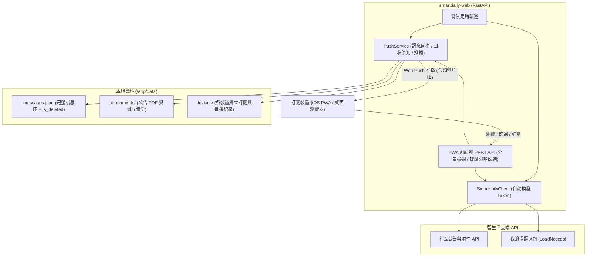

# 智生活社區公告與我的提醒 Web (`smartdaily-web`)

[](https://github.com/shuangrain/smartdaily-web/actions/workflows/ci.yml)
[](https://github.com/shuangrain/smartdaily-web/releases)
[](https://github.com/shuangrain/smartdaily-web/pkgs/container/smartdaily-web)

支援 **iOS 16.4+ 主畫面 PWA Web Push 推播通知**與桌面瀏覽器的輕量級 Web 服務，整合：
1. **📢 社區公告**：自動過濾 `ComId == ""` 的智生活平台團購廣告，並在背景發現新公告時**自動將 PDF / 圖片附件下載備份至本地**（同時支援點開時即時刷新 15 分鐘簽名網址），即使公告事後被社區回收刪除（`🗑️ 已回收`）仍可完整檢視內文與附件。
2. **📬 我的提醒（支援類型篩選）**：串接 `https://notification.kingnetsmart.com.tw/api/NotificationBox/LoadNotices`，完整涵蓋 `📦 郵務包裹`、`🔑 寄放物`、`📢 社區公告`、`🔔 個人通知`（含物管圖片附件）與 `📬 其他` 提醒，並提供網頁端分類篩選器。
3. **📲 Web Push 自動推播（依裝置獨立拆檔追蹤）**：統一由涵蓋範圍最完整的「📬 我的提醒」觸發推播，並在推播標題自動加上 `[類型]` 前綴（例如 `[📦 郵務包裹] 包裹到件通知`、`[📢 社區公告] 新公告通知`）；所有訊息完整保存於 `data/messages.json`（含 `is_deleted` 回收標記），每台訂閱裝置與其已推播狀態分別獨立儲存於 `data/devices/<device_id>.json`（搭配 Atomic Write 避免多裝置同時讀寫衝突）。

> [!WARNING]
> **⚠️ 免責聲明 (Disclaimer)**  
> 本工具僅供個人技術測試、研究與教學交流使用，與「今網智生活（智生活科技股份有限公司）」無任何官方合作或關聯。  
> 使用本工具進行任何 API 呼叫、自動化作業所衍生之任何帳號異常、資料外洩或法律責任，開發者與貢獻者概不負任何形式之責任。請使用者確保在獲得適當授權之環境下使用，並妥善保管您的 `DEVICE_ID`（等同於長期登入憑證）。

---

## 🏗️ 系統架構



---

## 🐳 使用 Docker 快速部署

CI 已自動建置並推送映像檔至 GitHub Container Registry (`ghcr.io/shuangrain/smartdaily-web:latest`)：

### 1. 直接使用 GHCR 映像檔啟動

```bash
docker run -d \
  --name smartdaily-web \
  --restart unless-stopped \
  -p 8000:8000 \
  -e DEVICE_ID="您的DeviceID" \
  -v $(pwd)/data:/app/data \
  ghcr.io/shuangrain/smartdaily-web:latest
```

### 2. 使用 `docker-compose.yml`

建立 `docker-compose.yml` 並直接拉取 GitHub Container Registry 映像檔啟動：

```yaml
services:
  smartdaily-web:
    image: ghcr.io/shuangrain/smartdaily-web:latest
    container_name: smartdaily-web
    restart: unless-stopped
    ports:
      - "8000:8000"
    environment:
      - DEVICE_ID=您的DeviceID
      - POLL_INTERVAL_SECONDS=180
      - LOG_LEVEL=INFO
    volumes:
      - ./data:/app/data
```

啟動服務：

```bash
docker compose up -d
```

---

## 🚀 本機開發與啟動（使用 `uv`）

```bash
# 安裝相依套件
uv sync

# 設定環境變數並啟動服務
DEVICE_ID="您的DeviceID" uv run smartdaily-web
```

預設監聽 `http://0.0.0.0:8000`。

---

## 📱 iOS (iPhone / iPad) 開啟 PWA 推播步驟

1. 將本服務透過 HTTPS 反向代理（如 Cloudflare Tunnel、Tailscale Funnel 或 Caddy）公開。
2. 使用 iPhone 的 **Safari** 開啟網址。
3. 點擊底部「**分享**」按鈕 ➔ 選擇「**加入主畫面 (Add to Home Screen)**」。
4. 從 iPhone 桌面開啟剛剛新增的「**社區通知**」App。
5. 點擊右上角「**🔔 推播**」➔ 點擊「**🔔 開啟推播通知**」並允許權限，接著可點擊「**📨 發送測試推播**」立即驗證通知。
